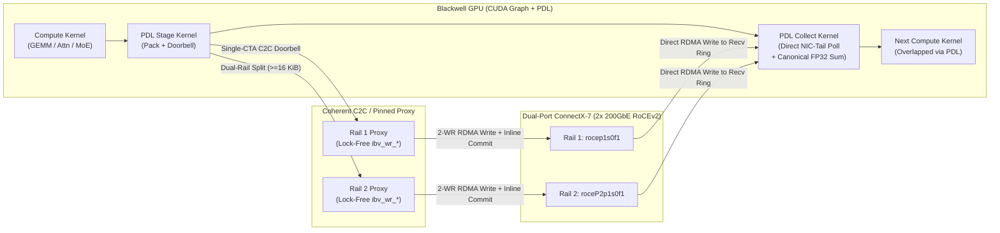

# Velo-Fabric: Low-Latency Multi-Node RDMA Collective & Distributed Execution Fabric for GB10 / DGX Spark

> **Preview (v0.8.0):** Velo-Fabric is currently in **preview** state in veloGB10 v0.8.0. Flags, topologies, and transport details may evolve across upcoming v0.8.x releases.

**Velo-Fabric** is the custom multi-node collective transport and distributed execution layer built into **veloGB10**. It turns **2, 3, 4, 6, or 8 NVIDIA DGX Spark (GB10)** systems connected over dual-port 200GbE RoCEv2 into a single, deterministic, CUDA-Graph-native inference engine—with **no NCCL, no MPI, and no host synchronization breaks in the decode loop**.

On an 8-node DGX Spark cluster connected purely over Ethernet (RoCEv2), Velo-Fabric achieves:

- **15.9 µs per 1-row 2-node**, **21.9 µs per 1-row 3-node**, **28.5 µs per 1-row 6-node**, and **31.4–32.3 µs per 1-row 8-node all-reduce** (`1.53 – 3.10 ms` total across 96 collectives per token)
- **92.6 tok/s single-user decode**, **3,094–3,231 tok/s cold prefill**, **219.9 tok/s 4-user aggregate** (`55.0 tok/s`/user), and **−18.8% to −19.3% total cluster collective wire** with **LAGA BF16 attention-output All-to-All** + all-W P7SP prefill on **DeepSeek-V4.1-Flash** (EXL3 2.9 bpw + Engram + DSpark speculation, TP2/TP3/TP4/TP6/TP8)
- **89.1 tok/s single-user decode (2.07× TP1)**, **194.0 tok/s 4-user aggregate**, and up to **4,637 tok/s FP32 bit-exact / 5,086 tok/s BF16 wire prefill at 5.5K** (**4,505 FP32 / 4,887 tok/s BF16 at 16K**) with arbitrary-W **DeepSpeed-Ulysses** All-to-All sequence-parallel attention (`TP3/TP4/TP6/TP8`) on **Inkling-2-Mini** (NVFP4 looped MoE + MTP speculation)
- **Bit-exact cross-rank determinism** across **TP2, TP3, TP4, TP6, and TP8**—enabling lockstep speculative decoding and exact rejection sampling without drift

---

## 1. The Problem: Why Multi-Node Scaling on Desktop AI Clusters Usually Fails

In datacenter GPU racks (HGX / GB200 NVL72), GPUs communicate over **NVLink / NVSwitch** at 900–1,800 GB/s with sub-microsecond latency. Desktop and edge clusters like **NVIDIA DGX Spark (GB10)** have a fundamentally different hardware profile:

- **Unified Coherent Memory (NVLink-C2C):** Each GB10 pairs an ARM Grace CPU with a Blackwell GPU sharing 128 GB of coherent LPDDR5x memory (~273 GB/s).
- **Ethernet Fabric (Dual-Port ConnectX-7 RoCEv2):** Nodes communicate over standard 200GbE RDMA (~25 GB/s per rail, ~50 GB/s dual-rail), not NVSwitch.
- **High Collective Frequency:** Modern MoE and looped transformer architectures execute **80 to 96 all-reduces per generated token** (and dozens more per prefill chunk).

Off-the-shelf distributed stacks (NCCL over RoCE, MPI, or generic PyTorch/vLLM tensor parallelism) run straight into four walls on this hardware:

1. **Latency Death by a Thousand Cuts:** At 96 collectives per token, even 150–250 µs of collective overhead burns **15–24 ms per step**, wiping out the memory-bandwidth advantage of adding more nodes—especially on smaller or faster models.
2. **CPU Bounce & Graph Breaks:** Synchronizing the GPU back to the host CPU to drive network calls breaks CUDA Graphs, adds driver launch jitter, and copies payloads needlessly through host buffers.
3. **Unsharded Bottlenecks:** Sharding only the big GEMMs leaves attention residuals, norms, convolutions, routers, speculative drafters, and full-vocabulary logit gathers replicated on every node—turning Amdahl's Law into a hard ceiling past TP2.
4. **Floating-Point Drift:** Non-deterministic reduction orders cause ranks to diverge on tight router ties or sampling draws, breaking lockstep speculative verification and multi-node prefix caching.

**Velo-Fabric was designed from the ground up to dismantle all four walls simultaneously.**

---

## 2. How Velo-Fabric Works

### 2.1 Zero-CPU-Bounce, CUDA-Graph-Native RDMA Collectives
Inside the decode and prefill loop, the CPU never touches payload bytes and the GPU never breaks out of a captured CUDA Graph:

- **Direct GPU-Validated NIC Tail Receive:** Remote peers RDMA-write payloads directly into registered receive rings, followed by a 16-byte inline `{epoch, len_tag}` commit written onto a private cache line. The GPU collect kernel validates the arriving tail directly from coherent memory—eliminating the CPU bounce and extra synchronization hop.
- **Single-CTA C2C Poller + GPU-L2 Handoff:** Rather than waking every threadblock across the system bus to poll coherent memory, a single CTA polls the C2C flag and releases the remaining CTAs through GPU L2 cache—cutting 1-row p99 tail latency by 26% and world-4 step overhead by 7–15%.
- **Blackwell Programmatic Dependent Launch (PDL):** Stage and collect kernels use `griddepcontrol.wait` and `launch_dependents` so the collect kernel is already resident on SMs while staging finishes, and downstream compute begins the instant reduction completes.
- **Lock-Free Verbs Hot Path:** Built directly on `ibv_thread_domain` + `ibv_create_qp_ex` (`ibv_wr_start` / `ibv_wr_rdma_write` / `ibv_wr_complete`), 2-WR inline commits (down from 3-WR), S=4 CQ signaling batching, and BlueFlame inline transfers (up to 512 B) for tiny control, router, and acceptance frames.

### 2.2 Automatic Dual-Rail 200GbE RoCEv2 & Adaptive Collective Routing
Velo-Fabric auto-detects both active RoCEv2 ports on every box and picks the optimal collective algorithm dynamically per payload size—all transparent to the model:

| Payload Regime | Collective Strategy | Why |
| --- | --- | --- |
| **Tiny / Decode (≤ 768 KiB)** | **Single-Stage All-Peers One-Shot** (fused `grid.y = 2` dual-rail TP2; dual-rail split ≥ 16 KiB) | 1 network round-trip across **W ∈ {2, 3, 4, 6, 8}**; fits 1–48 speculative verify rows inside CUDA Graphs (`15.9 µs` at TP2, `21.9 µs` at TP3, `28.5 µs` at TP6, `31.4 µs` at TP8). |
| **Medium (128 KiB – 4 MiB)** | **Fused Dual-Rail PDL Reduce-Scatter + All-Gather** | Halves wire bytes per rail (`0.75F`/rail at TP4, `1.75F` at TP8); cuts 24-row Engram exchange latency by **36.4%**. |
| **Wide Prefill (Multi-MB)** | **2-Rail Pipelined Multi-Block Transport** (pow2) / **1-RTT Direct RS & AG** (TP3 / TP6) | Overlaps RDMA wire time with GPU staging/reduction; cuts wire/rail by **2.67× at TP4** and **3.43× at TP8**. |
| **Sequence-Parallel Attention** | **1-RTT Dual-Rail All-to-All (`TP_LEN_FLAG_A2A`)** — **DeepSpeed-Ulysses** & **LAGA** | Reuses the existing full-mesh one-shot QPs with zero extra buffers. **Inkling-2 (`TP3/4/6/8`):** Ulysses with localized `gate_attn` (−35.4% A2A #1 wire, bit-exact FP32; optional `--inkling2-ulysses-wire bf16` −47% wire). **DSV4.1 (`TP3/4/6/8`, plus `TP2` with `--dsv41-attn-whole on`):** LAGA BF16 attention-output All-to-All + local whole `wo_b` (`--dsv41-sp-laga auto`, −18.8% to −19.3% total cluster collective bytes). |

### 2.3 Bit-Exact Canonical Determinism
Every reduction—whether single-stage all-peers, dual-rail RS+AG, 1-RTT direct TP3/TP6 RS/AG, or pipelined prefill—accumulates partials in a **fixed canonical FP32 order**:
- World 3 / World 6: sequential canonical sum `(((p0 + p1) + p2) ...)`
- World 4: `(p0 + p1) + (p2 + p3)`
- World 8: `((p0 + p2) + (p4 + p6)) + ((p1 + p3) + (p5 + p7))`

Because IEEE-754 floating-point addition is non-associative, fixing the exact reduction tree across all ranks guarantees **bitwise-identical activations on every GPU** regardless of network packet arrival order. That makes lockstep multi-node speculative decoding, exact rejection sampling, and multi-turn prefix cache snapshots rock-solid without cross-rank divergence.

### 2.4 Full-Stack Distributed Execution, DeepSpeed-Ulysses SP, & Arbitrary Topologies (TP3 / TP6)
Fast all-reduce alone isn't enough when everything *around* the matrix multiplies stays replicated—or when cluster sizes aren't powers of two. Velo-Fabric extends parallelism across the entire forward pass:

- **DeepSpeed-Ulysses Sequence-Parallel Attention (Arbitrary-W: TP3, TP4, TP6, & TP8):** Standard sequence parallelism still all-gathers full-hidden activations (`xb`) before attention and reduce-scatters full-hidden outputs (`ao`) after `wo`. Velo-Fabric implements **DeepSpeed-Ulysses** directly on top of its 1-RTT dual-rail RDMA All-to-All primitive (`TP_LEN_FLAG_A2A`) with per-rank uneven head layouts (`InkUlyHeads` + `att_stride`): each rank projects Q/K/V/Gate on its local `1/W` sequence slice, keeps `gate_attn` **local on the token-owner rank** (cutting A2A #1 wire by **35.4%** with bit-exact FP32*sigmoid rounding post-A2A #2), performs a single 1-RTT All-to-All to assemble full-sequence Q/K/V for its local attention heads, runs unmodified flash/TC attention locally, performs a reverse All-to-All back to sequence-sharded layout, applies `sigmoid(gate_attn)` locally, and runs `wo` locally—**eliminating both the attention `xb` all-gather and the `ao` reduce-scatter** across **TP3, TP4, TP6, and TP8** (TP2 intentionally remains on AG+RS where `6,912 B/tok` beats FP32 Ulysses `8,664 B/tok`). An opt-in **`--inkling2-ulysses-wire bf16`** mode compresses Q/K/V and ungated attention outputs to BF16 while preserving `r`/`s`/`kd`/`vd` in FP32, cutting Ulysses wire by another **47%** (`5,086 tok/s` at TP6 5.5K, `4,805 tok/s` at TP8 5.5K) while remaining 100% deterministic cross-rank.
  > **Credit:** The All-to-All head/sequence transpose attention algorithm is adapted from **DeepSpeed-Ulysses** — Sam Ade Jacobs, Masahiro Tanaka, Chengming Zhang, Minjia Zhang, Shuaiwen Leon Song, Samyam Rajbhandari, and Yuxiong He (2023), *"DeepSpeed Ulysses: System Optimizations for Enabling Training of Extreme Long Sequence Transformer Models"*, [arXiv:2309.14509](https://arxiv.org/abs/2309.14509).
- **LAGA BF16 Attention-Output All-to-All (`--dsv41-sp-laga auto`, TP3 / TP4 / TP6 / TP8, plus TP2 with `--dsv41-attn-whole on`):** On DeepSeek-V4.1-Flash, rather than running `wo_b` on each rank's partial `o_groups` and reduce-scattering FP32 full-hidden outputs (`20 KiB/tok`), Velo-Fabric ships the compact BF16 `wo_a` low-rank output (`16 KiB/tok`, supporting uneven `o_groups` `[3,3,2]` on TP3 and `[2,2,1,1,1,1]` on TP6 via `D41LagaGroups`) over a single 1-RTT All-to-All and runs the already-resident whole `wo_b` GEMM locally on each rank's `1/W` sequence rows. This cuts **total cluster collective wire bytes across the entire forward pass by 18.8–19.3%** (`30.35 → 24.48 GB` at TP4, `30.31 → 24.60 GB` at TP3) with zero aborts and `+4.7%` to `+6.0%` faster TP3 cold prefill.
- **Non-Power-of-Two Topologies (TP3 & TP6):** Many real-world desktop clusters have 3 or 6 nodes (or split an 8-node cluster into 3+5 or 2+6). Velo-Fabric drops the power-of-two recursive-doubling restriction by running single-stage all-peers exchanges (`d41x_xcn_collect` / `d41x_xcnd_collect`, plus BF16-wire variants) for decode/verify and 1-RTT direct variable-block Reduce-Scatter / All-Gather (`d41x_a2a_var_stage` / `d41x_ag_var_*`) for prefill over the same full-mesh dual-rail QPs. On Inkling-2-Mini (24 Q heads, 8 KV heads, 1152 MoE inner channels), whole-KV-head sharding yields exact, zero-KV-duplication partitions with full **DeepSpeed-Ulysses** SP prefill: **TP3** (`[9, 9, 6]` Q, `[3, 3, 2]` KV, exact `[384 × 3]` MoE) and **TP6** (`[6, 6, 3, 3, 3, 3]` Q, `[2, 2, 1, 1, 1, 1]` KV, exact `[192 × 6]` MoE—now beating TP4 prefill at `4,637 tok/s` FP32 / `5,086 tok/s` BF16). On DeepSeek-V4.1-Flash (64 heads / 8 output groups, 8 Engram heads, 2304 MoE inner width = 18 EXL3 128-blocks), both **TP3** and **TP6** run full **P7SP sequence-parallel prefill**, mirror-zigzag indexer sharding, `hc_whole`, uneven-K `mix_local_into`, and **LAGA** output All-to-All—fitting comfortably in 3 × 128 GB DGX Sparks (`69.6 GiB` weights/rank) with prefix caching and DSpark speculation enabled.
- **World-2/3/4/6/8 Sequence-Parallel (SP) Prefill:** During prefill, every non-GEMM stage—attention residuals, message gates, RMSNorms, short causal convolutions (via 3-row cross-rank boundary halos), and MoE routers—runs on `1/W` of the sequence per rank, exchanging compact BF16/FP16 all-gathers and pure reduce-scatters instead of full FP32 all-reduces.
- **Vocab-Parallel Speculative Drafting & Acceptance:** Instead of gathering 6–25 MB of full-vocabulary logits to rank 0 on every speculative round, each rank runs the drafter over its own `1/W` vocabulary slice (reusing the sharded LM head, cutting drafter weight memory by `W×`) and exchanges **≤ 1 KiB** all-reduce acceptance records—supporting both lossless greedy and distribution-exact sampled decoding across all supported worlds.
- **Balanced 64-Channel MoE Inner Sharding:** Granular 64-channel splits eliminate rank-0 stragglers (exact 50/50 `[576, 576]` at TP2, exact `[384 × 3]` at TP3, exact `[192 × 6]` at TP6, and `1.5×` vs `2.0×` max/min ratio at TP8).
- **RoCEv2 Bulk Weight Shipping + Hardware SHA-256:** Cold cluster startup ships sharded model weights and Engram tables over credit-paced `RDMA_WRITE_WITH_IMM` rings with parallel fan-out and ARMv8 hardware SHA-256 verification into a content-addressed blob cache—so warm 8-node Inkling-2-Mini boots in **13 seconds** and 8-node DeepSeek-V4.1-Flash (210+ GB EXL3 + 200 GB Engram tables) boots in **61 seconds**.
- **Pre-Handshake CUDA PTX Preload & Live Telemetry:** All ranks preload CUDA kernels before entering the RDMA handshake (eliminating cold-JIT boot timeouts after upgrades), and every server exports live Prometheus metrics (`velogb10_velo_fabric_{world,dual_rail,gpu_recv,sp_ready}`, `velogb10_dsv41_sp_{prefill,prefill_idx,laga}_layers_total`) on `/metrics`.
- **Reusable Distributed Core (`Velo-Fabric`):** A model-agnostic layer (`ShardedTensor`, declarative `ShardSpecPlan`, GSPMD-style lazy `PartialSum` propagation, and `FabricXport` with deterministic loopback testing including `all_to_all`) lets new model families adopt 2/3/4/6/8-node dual-rail RDMA without rewriting transport boilerplate.

---

## 3. Measured Benchmarks (2, 3, 4, 6, and 8 NVIDIA DGX Spark Nodes)

All benchmarks below were measured live on an 8-node DGX Spark (GB10) cluster over dual-port 200GbE ConnectX-7 RoCEv2 (`rocep1s0f1` + `roceP2p1s0f1`), serving through the production OpenAI-compatible HTTP API with streaming enabled, concurrent mixed greedy/sampled/`top_p` batches, and zero TP aborts or errors.

### 3.1 DeepSeek-V4.1-Flash (EXL3 2.9 bpw + Native FP8 Engram + DSpark Speculation)
*40-layer MoE (384 routed experts top-6 + 1 shared + 8-head Engram tables + 3-stage DSpark drafter, 129,280 vocab, 1M context)*

| Topology | Boot Time (Warm Cache) | 4.4K–4.6K Cold Prefill (`tok/s` / TTFT) | 8.0K Cold Prefill (`tok/s`) | Turn-2 Prefix-Cache Hit TTFT | 1-User Decode (`tok/s`) | 4-User Batch (`agg tok/s` / per-user) |
| --- | --- | --- | --- | --- | --- | --- |
| **TP2** (2 Sparks) | `129 s` | `1,886` (`2.439 s`) | — | *(cache off in TP2 RAM)* | `48.9` | `91.2` (`22.8`/u) |
| **TP3** (3 Sparks, **P7SP + LAGA**) | `152 s` | **`2,261 – 2,275`** (`1.94 s`, **+20.9% vs pre-SP/LAGA**) | **`2,518 – 2,547`** (**−18.8% wire**) | `0.157 – 0.220 s` | **`64.4 – 70.6`** (+39–44% vs TP2) | **`146.6 – 183.7`** (`36.7–45.9`/u) |
| **TP4** (4 Sparks, **P7SP + LAGA**) | `72 s` | **`2,764`** (`1.664 s`) | **`3,169 – 3,231`** (**−19.3% wire**) | `0.142 s` | `58.5` | `135.1` (`33.8`/u) |
| **TP6** (6 Sparks, **P7SP + LAGA**) | `~95 s` | `2,147` *(pre-LAGA)* | **`2,873`** *(pre-LAGA)* | — | **`70.5 – 71.6`** (+46% vs TP2) | — |
| **TP8** (8 Sparks, **P7SP + LAGA**) | **`61 s`** | **`3,094`** (`1.467 s` @ 4.54K) | — | **`0.108 – 0.155 s`** | **`87.6 – 92.6`** (+89% vs TP2) | **`219.9`** (`55.0`/u, **+141% vs TP2**) |

*Greedy outputs are 100% consistent across TP2, TP3, TP4, TP6, and TP8 (LAGA ON vs OFF on TP4 verified 492/492 char-exact). Prefix cache hit on turn 2 delivers an **11–20× TTFT reduction** (`2.531 s → 0.157–0.225 s` at TP3; `2.103 s → 0.108 s` at TP8).*

### 3.2 Inkling-2-Mini (NVFP4 Looped MoE + MTP Speculation)
*24-layer looped MoE (128 experts top-8, hidden 2304, 201,024 vocab, 96 collectives/step)*

Scaling a compact, already-fast model to 8 nodes over Ethernet is the hardest possible stress test for any distributed fabric because compute per layer is tiny—every microsecond of network or launch overhead shows up immediately.

| Topology | 4.87K–5.5K Cold SP Prefill (`tok/s`, FP32 / BF16 wire) | 16K Cold SP Prefill (`tok/s`, FP32 / BF16 wire) | Turn-2 Prefix-Cache Hit TTFT | 1-User Decode (`tok/s`) | 4-User Batch (`agg tok/s` / per-user) |
| --- | --- | --- | --- | --- | --- |
| **TP1** (1 Spark, `--mtp on`) | `2,429` (`2.005 s`) | — | — | `43.0` | `59.7` (`14.9`/u) |
| **TP2** (2 Sparks, fused dual-rail AG+RS) | **`3,759 – 3,766`** (`1.45 s` @ 5.5K, +55%) | — | — | `62.6` (+46%) | `83.2` (`20.8`/u, +39%) |
| **TP3** (3 Sparks, **Ulysses + U1/U7a**) | **`3,781 – 3,810`** / **`4,133 – 4,178`** (+72% BF16) | — | `0.113 s` | `62.4` (+45%) | `167.2` (`41.8`/u) |
| **TP4** (4 Sparks, **Ulysses + U1**) | **`4,287 – 4,330`** (`1.27 s` @ 5.5K, +78%) | **`4,254 – 4,285`** (`3.71 s` @ 15.9K) | **`0.073 s`** | `76.1` (+77%) | `175.7` (`43.9`/u) |
| **TP6** (6 Sparks, **Ulysses + U1/U7a**) | **`4,617 – 4,637`** / **`5,008 – 5,086`** (**+109% vs TP1**) | **`4,450 – 4,475`** / **`4,881 – 4,887`** | `0.109 s` | `70.6` (+64%) | `193.8` (`48.5`/u) |
| **TP8** (8 Sparks, **Ulysses + U1/U7a**) | **`4,436 – 4,496`** / **`4,738 – 4,805`** (**+98% vs TP1**) | **`4,478 – 4,505`** / **`4,723 – 4,737`** | **`0.070 s`** | **`89.1` (2.07× TP1)** | **`194.0`** (`48.5`/u, **+225% vs TP1**) |
| **TP8** (8 Sparks, `--mtp off`) | `3,603` (`1.352 s`, pre-Ulysses) | — | `0.105 s` | `85.7` (1.99× TP1) | `120.9` (`30.2`/u) |

*Measured attach-time RDMA all-reduce latencies on Inkling-2-Mini: **TP2** (fused `grid.y=2` dual-rail): `15.9–16.2 µs` (1-row), `18.8–19.0 µs` (4-row), `22.6–22.9 µs` (8-row); **TP3**: `21.5–21.9 µs` / `25.4–25.5 µs` / `32.6–33.3 µs`; **TP4**: `22.8 µs` / `30.0 µs` / `38.9 µs`; **TP6**: `28.5–28.6 µs` / `36.9 µs` / `54.1–54.5 µs`; **TP8**: `31.4–32.3 µs` / `44.2–44.7 µs` / `65.1–68.9 µs`.*

---

## 4. Why This Is a Technical Achievement

1. **Breaking the "Ethernet Can't Scale Decode" Myth:** Conventional wisdom holds that tensor parallelism across 8 nodes requires NVLink/NVSwitch, and that RoCEv2 Ethernet only scales huge batch sizes or pipeline parallelism. Velo-Fabric proves that with GPU-validated zero-bounce receives, PDL overlap, single-CTA C2C polling, lock-free dual-rail verbs, and vocab-parallel speculation, **single-user interactive decode scales past 2× even on a compact model (43 → 89.1 tok/s) and approaches 100 tok/s on a massive frontier MoE (92.6 tok/s on DeepSeek-V4.1-Flash)**—all over commodity 200GbE Ethernet.
2. **Datacenter-Grade Engineering on Desktop Hardware:** Achieving **15.9 µs (TP2)**, **21.9 µs (TP3)**, **28.5 µs (TP6)**, and **31.4 µs (TP8)** per all-reduce (including GPU staging, C2C handoff, dual-rail RoCEv2 transit, direct NIC-tail validation, and canonical FP32 summation inside a captured CUDA Graph) puts desktop DGX Spark clusters in a latency class normally reserved for specialized HPC interconnects.
3. **End-to-End Co-Design Across the Entire Stack:** No single trick created these numbers. Velo-Fabric spans five engineering layers in concert—C/verbs RDMA micro-protocol design, Blackwell PTX/SASS PDL kernels, memory-layout & 64-channel MoE load balancing, DeepSpeed-Ulysses sequence-parallel & vocab-parallel model algorithms, and lockstep speculative verification—with **zero external collective runtime dependencies** (`NCCL`-free, `MPI`-free, single static binary) across **2, 3, 4, 6, and 8 nodes**.
4. **Correctness Without Compromise:** Rather than trading numerical determinism or sampling exactness for speed, Velo-Fabric enforces bit-identical canonical reductions across ranks and supports exact speculative acceptance for both greedy and temperature/`top_p` sampling—turning a multi-box cluster into something that behaves with the reliability and reproducibility of a single GPU.

---

## 5. References & Credits

- **DeepSpeed-Ulysses:** Sam Ade Jacobs, Masahiro Tanaka, Chengming Zhang, Minjia Zhang, Shuaiwen Leon Song, Samyam Rajbhandari, and Yuxiong He (2023). *"DeepSpeed Ulysses: System Optimizations for Enabling Training of Extreme Long Sequence Transformer Models."* [arXiv:2309.14509](https://arxiv.org/abs/2309.14509). Velo-Fabric's All-to-All sequence-parallel attention in `src/inkling2/model/mod.rs`, `kernels/gpu_inkling2/d8_tp_glue.cuh`, and 1-RTT RDMA All-to-All transport (`TP_LEN_FLAG_A2A`) are directly based on the DeepSpeed-Ulysses communication design.
